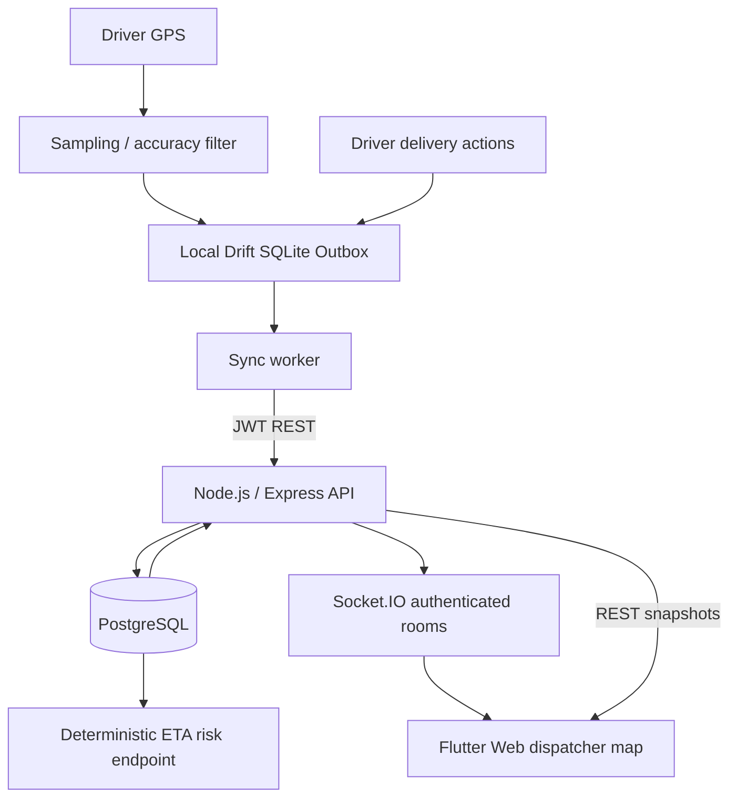

# KhojLive — Real-Time Fleet & Delivery Tracking

**Full-stack portfolio reference implementation:** Flutter Driver (Android), Flutter Dispatcher (Web), Express/TypeScript API, PostgreSQL, Socket.IO and a local Drift/SQLite outbox.

> **Honest scope:** This is a functional engineering **prototype**, not a verified production deployment. No Flutter or Android SDK is installed in the artifact-building environment, so Flutter compilation, background-location behavior, and end-to-end mobile testing are **not verified**. Device background tracking, true road routing, robust conflict resolution, real AI inference, hardened production security and release CI are **not complete**. The repository includes runnable application *source* and a Windows script to generate Flutter platform scaffold files locally.

## Quick start (Windows / PowerShell)

Prerequisites: Flutter SDK, Android SDK, Node.js (22+), Docker Desktop, Chrome, VS Code. From repo root:

```powershell
.\scripts\bootstrap-windows.ps1
Copy-Item backend\.env.example backend\.env
# Edit backend/.env and change JWT_SECRET; for demo SEED_DEMO=true
 docker compose up -d
cd backend
npm install
npm run dev
```

Second terminal for Driver (Android emulator):

```powershell
cd apps\driver
flutter pub get
flutter run --dart-define=API_URL=http://10.0.2.2:4000
```

Second terminal for Dispatcher (Chrome):

```powershell
cd apps\dispatcher
flutter pub get
flutter run -d chrome --web-port=5200 --dart-define=API_URL=http://localhost:4000
```

**Demo users** (only when `SEED_DEMO=true`): `driver@khojlive.test` and `dispatcher@khojlive.test`, password `KhojLive123!`. Local development credentials only; change or disable before any deployment. For a physical Android device use the PC LAN IP instead of `10.0.2.2` and adjust Windows Firewall. Android cleartext HTTP is only for local debug; set an HTTPS API URL for deployment.

### Android/iOS & background-location notes

Bootstrap generates Flutter host project files on your own machine. Android manifest permissions may require manual review after `flutter create`. `ACCESS_FINE_LOCATION`, `ACCESS_COARSE_LOCATION`, `INTERNET` are required. If you implement foreground service and background modes add correct service declarations and `FOREGROUND_SERVICE_LOCATION`, `ACCESS_BACKGROUND_LOCATION` as justified. **The current location implementation tracks only while the app process is active**; do not represent it as full background/terminated tracking. Real iOS builds require macOS and platform-specific permission/capability configuration.

## Structure

```text
khojlive/
  apps/driver/         Flutter Android source, Drift outbox, GPS filter
  apps/dispatcher/     Flutter Web dashboard and Socket.IO subscriber
  backend/src/        Express API, SQL access, auth, WebSocket gateway
  backend/sql/        PostgreSQL DDL
  backend/tests/      Deterministic domain tests
  docs/               API, architecture, security, limitations
  scripts/            Windows platform-scaffold bootstrap
  .github/workflows/   Backend CI and Flutter CI (toolchain-dependent)
```

## Architecture



## Implemented source features

- Driver login, refresh-token rotation and logout; storage uses `flutter_secure_storage`.
- Delivery list, constrained state machine, offline transition queue (including UUID idempotency keys and expected version), manual and periodic best-effort syncing.
- Local Drift database stores delivery snapshots, queued state changes and GPS samples; transitions and queue insertion are atomic.
- Foreground-stream geolocation with accuracy and distance/time filtering. Accuracy >100m is rejected.
- PostgreSQL-backed users, deliveries, refresh sessions, location samples and idempotent business operations.
- Authenticated dispatcher Socket.IO feed and periodic REST reconciliation; map with several drivers and OpenStreetMap attribution.
- Explainable **rules-based** ETA-risk calculation endpoint; not marketed as AI inference.
- Domain unit tests and GitHub Actions templates.

## API

See [docs/api/API.md](docs/api/API.md). Important: `POST /deliveries/:id/transition` is the authoritative state-change contract. The `/accept`, `/start`, `/complete` compatibility routes intentionally return an explanatory 400 instead of silently skipping intermediate states.

## Why I chose this architecture

**Riverpod over BLoC:** providers give DI, focused reactive reads and async composition with less event boilerplate for this prototype. BLoC would be equally defensible for a team standardizing event workflows. Business rules remain independent of providers.

**Feature-first Clean Architecture:** delivery domain types and state transitions do not depend on UI. The first version pragmatically groups a few service classes under core; production expansion should split network, local and domain abstractions by feature.

**Drift / SQLite:** relational operations, durability and transactions for offline queue and cached deliveries. Current queries are raw Drift SQL rather than code-generated typed DAO definitions; migrations and full typed schema are future work.

**WebSockets:** server push for timely fleet movement, with REST as the authoritative snapshot after reconnect. WebSocket notification delivery alone is not a reliable event log.

**Offline-first:** persistence before transmit protects against intermittent mobile connectivity and app restarts. It increases consistency complexity: version conflicts currently halt syncing and need user/dispatcher resolution UI.

**Battery-aware GPS:** distance + elapsed time + accuracy filter, not a 1-second transmit loop. Actual battery optimization must include native background modes, battery signal, adaptive sampling and physical-device measurement.

**Node.js + PostgreSQL:** async HTTP/WebSocket I/O with transactional relational state and manageable local development. A modular monolith is appropriate before splitting services.

## Trade-offs & Lessons Learned

| Decision | Advantage | Limitation |
| --- | --- | --- |
| Riverpod | Simple DI and reactive views | State/lifecycle discipline required |
| Drift | Atomic offline outbox | SQLite migrations and schema testing needed |
| Socket.IO | Reconnect behavior and rooms | No durable delivery guarantees or multi-node bus yet |
| PostgreSQL | ACID transitions and constraints | SQL/index maintenance and retention strategy needed |
| Local optimistic status | Immediate UI feedback | Version conflicts need resolution |
| GPS distance gating | Less battery and traffic | Less detailed traces and delayed stationary presence |
| Rules-based delay risk | Explainable and free | Not predictive AI; no traffic provider integration |
| OpenStreetMap raster | No Google key for prototype | Public tile servers are not suitable for heavy production usage; use a commercial/self-hosted provider |

## Security

JWT 15-minute access tokens, rotating opaque refresh token hashes (14-day expiration), password hashes, role checks, assignment checks, input schemas and login rate limits. `JWT_SECRET` comes from `.env` and is not bundled. This is **not a security audit**; outstanding items include TLS, refresh token reuse detection, CSRF/cookie policy if sessions move to cookies, rate limits on every write route, GPS privacy/retention, centralized logging and secrets management.

## Tests and CI

```powershell
cd backend
npm install
npm run check
npm test
```

Flutter once platform files and SDK are installed:

```powershell
cd apps\driver
flutter analyze
flutter test
```

Workflows run backend lint/type-check/test and Flutter analyze/test on GitHub Actions. Release signing and store deployment require private credentials and are not configured.

## Limitations / Next engineering work

1. Real background-location foreground service for Android, lifecycle handling for iOS, foreground notification, low-battery adaptive sampling and permissions review.
2. Delivery-conflict resolution UI and operation queue recovery after permanent rejection; exponential backoff currently exposed as a policy calculation but periodic sync uses fixed cadence.
3. True driving routes, real traffic ETA and production map tile provider.
4. Dispatcher assignment/create flow, live socket health UI, event cursor replay and multi-node scaling.
5. AI service behind server API with grounded structured inputs, optional model, evaluation and cost controls.
6. More repository/interface isolation, robust schema migrations, integration/widget/E2E tests, monitoring, dedicated production infrastructure and deployment hardening.

## Screenshots

Screenshots intentionally not supplied: capture them after validating apps on real devices. Do not use unrelated mockups as application screenshots.
