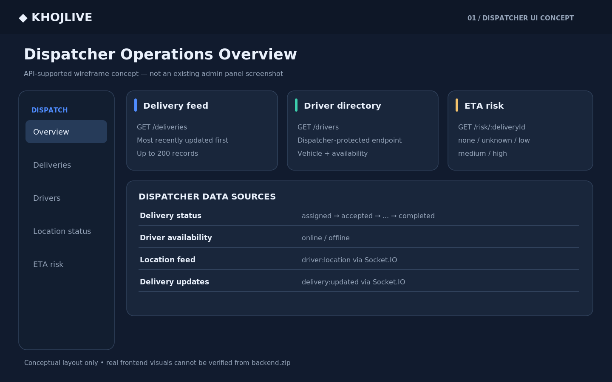
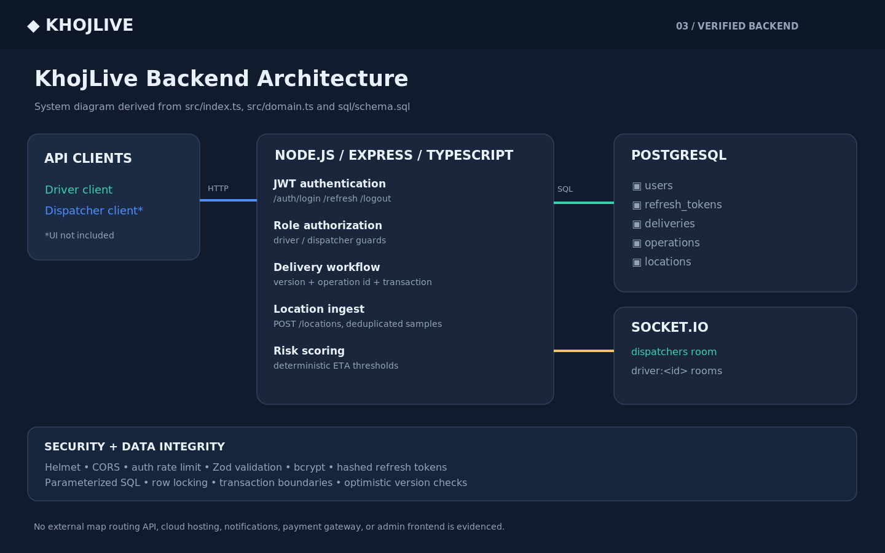
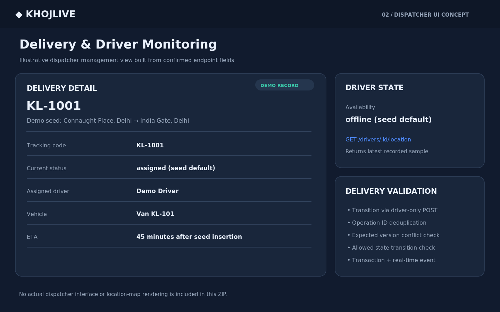
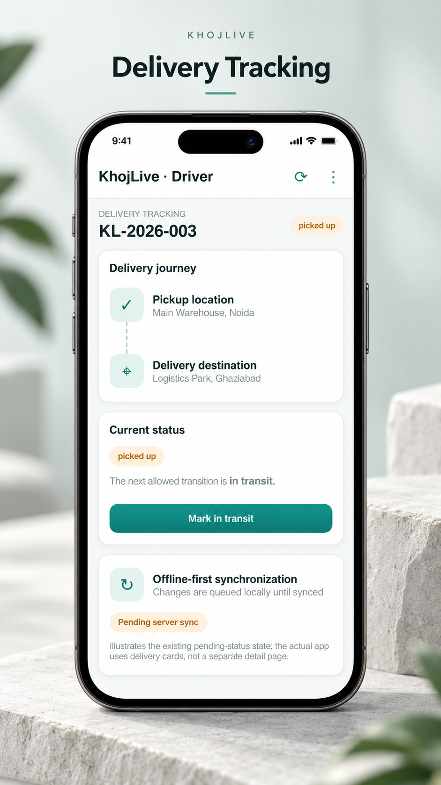
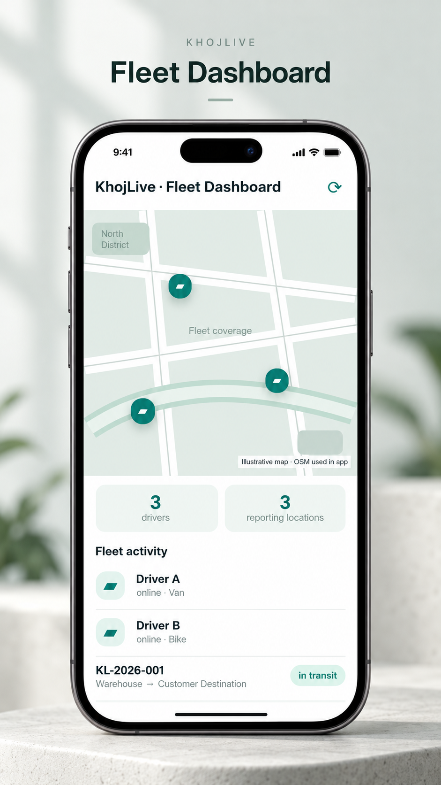
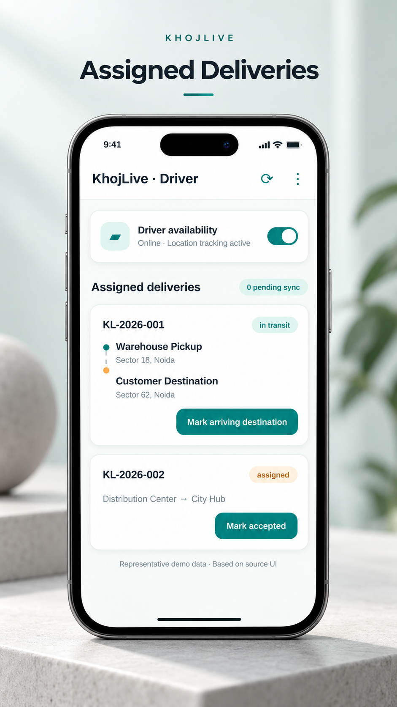

<div align="center">

# 🚚 KhojLive

### Fleet Tracking and Delivery Management System

<a href="https://github.com/keshavappdev/khojlive-fleet-tracking-system">
  
</a>

<br/>


</div>

---

## 🚀 About The Project

**KhojLive** is a full-stack **fleet tracking and delivery management system**. Dispatchers monitor vehicles and deliveries live on a dashboard, while drivers use a Flutter mobile app that shares GPS location in real time and keeps working **offline**, syncing automatically when the connection returns.

---

## ✨ Features

| Feature | Description |
|---|---|
| 📍 **Real-time GPS Tracking** | Live vehicle location streamed over Socket.IO |
| 🖥️ **Dispatcher / Admin App** | Manage drivers, deliveries and fleet from one place |
| 📱 **Driver Mobile App** | Simple Flutter app for deliveries and location sharing |
| 📶 **Offline Synchronization** | Data is stored locally and synced when back online |
| 📦 **Delivery Management** | Create, assign and track deliveries |
| 🗄️ **PostgreSQL Database** | Reliable relational storage with a ready SQL schema |
| 🐳 **Docker Support** | Run the backend stack quickly with docker-compose |
| ✅ **Automated Checks** | CI workflow and unit tests for backend and app domain logic |

---

## 📸 Screenshots

### 🖥️ Admin Panel

<div align="center">

| Screen 1 | Screen 2 | Screen 3 |
|:---:|:---:|:---:|
|  |  |  |

</div>

### 📱 Phone App

<div align="center">

| Screen 1 | Screen 2 | Screen 3 |
|:---:|:---:|:---:|
|  |  |  |

</div>

---

## 🛠️ Tech Stack

| Layer | Technology |
|---|---|
| 📱 Mobile Apps | Flutter, Dart, Riverpod |
| ⚙️ Backend | Node.js, Express, TypeScript |
| 🗄️ Database | PostgreSQL |
| 🔌 Real-time | Socket.IO |
| 📍 Tracking | GPS location service with offline sync |
| 🐳 DevOps | Docker, docker-compose, GitHub Actions |

---

## 📂 Project Structure

```
khojlive-fleet-tracking-system/
├── apps/
│   ├── driver/          # Flutter driver app
│   └── dispatcher/      # Flutter dispatcher / admin app
├── backend/             # Node.js + Express + TypeScript API
│   ├── src/
│   ├── sql/schema.sql
│   └── tests/
├── docs/
│   ├── api/API.md
│   └── architecture/DECISIONS.md
├── scripts/             # Setup scripts
├── screenshots/
│   ├── admin/
│   └── phone/
├── .github/workflows/   # CI checks
├── docker-compose.yml
└── README.md
```

---

## ⚙️ Getting Started

### Prerequisites

- [Flutter SDK](https://docs.flutter.dev/get-started/install)
- [Node.js](https://nodejs.org/) 18 or newer
- [PostgreSQL](https://www.postgresql.org/) or Docker

### 1. Clone the repository

```bash
git clone https://github.com/keshavappdev/khojlive-fleet-tracking-system.git
cd khojlive-fleet-tracking-system
```

### 2. Run the backend

```bash
cd backend
cp .env.example .env      # then edit the values
npm install
npm run dev
```

Or start the stack with Docker:

```bash
docker-compose up -d
```

The database schema is in `backend/sql/schema.sql`.

### 3. Run the Driver app

```bash
cd apps/driver
flutter pub get
flutter run
```

### 4. Run the Dispatcher app

```bash
cd apps/dispatcher
flutter pub get
flutter run
```

### Run tests

```bash
# Backend
cd backend && npm test

# Driver app
cd apps/driver && flutter test
```

---

## 📖 Documentation

- 📡 [API Reference](docs/api/API.md)
- 🏗️ [Architecture Decisions](docs/architecture/DECISIONS.md)

---

## 🤝 Contributing

Contributions, issues and feature requests are welcome!
Feel free to open an issue or submit a pull request.

---

## 👨‍💻 Author

**Keshav** — [@keshavappdev](https://github.com/keshavappdev)

<div align="center">

⭐ **If you like this project, give it a star!** ⭐

</div>
